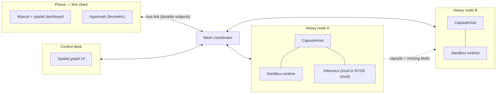

# Architecture

## The shape of the system

Every arrow is a **link between two embedded buses** (a private network such as
WireGuard or Tailscale underneath). There is no central server: the coordinator
is one more node that can run anywhere, holds no state a restart cannot rebuild,
and several can run at once: a move requested twice is made safe by the fencing epoch, not by the coordinators agreeing.

## Data flows

| Flow | Subjects / API | Durable across a partition |
|---|---|---|
| Discovery and liveness | `node.announce`, `node.heartbeat`, `node.lost` | no (the next heartbeat repairs it) |
| Live state for the mascot and dashboards | `agent.<id>.state`, `node.<id>.load` | agents yes, load no |
| Moving an agent | `teleport.request` → `teleport.result` | yes |
| Sensitive command approval | `ApprovalGate` (library); bus subjects `approval.>` are reserved and durable, the wiring is next | yes |
| Agent state itself | the capsule (files), never the bus | n/a — it is copied, verified, then activated |

Bulk data (capsules, blobs) never travels as bus messages; the bus only carries
decisions and telemetry. Bulk transfer goes through the `Endpoint` protocol, which
a real deployment backs with a streamed, resumable transport.

## Components and what each one guarantees

- **Capsule** ([ssc.md](ssc.md)) — a directory of plain files, every file digested
  in the manifest, the journal hash-chained per node. *Guarantee:* any tampering or
  truncation is detected by `verify`, offline, with no special tool.
- **Handover** — `render(events, target)` is a pure function of the journal.
  *Guarantee:* switching provider and back yields the same conversation; a tool
  call cut short by a crash is closed with an explicit error result because every
  provider rejects a dangling call.
- **Teleportation** ([teleport.md](teleport.md)) — two-phase commit with a fencing
  epoch. *Guarantee:* never two running holders; any failure before the commit
  point resumes the source.
- **Mesh** ([mesh.md](mesh.md)) — subjects, durable links, discovery, coordinator.
  *Guarantee:* a handler that fails cannot starve the others; a message is
  delivered once even when replayed after a reconnect.
- **Security** ([security.md](security.md)) — names in capsules, values in the
  keychain, signed single-use approvals, default deny.

## Why these choices

- **Files over a database.** A capsule can be diffed, grepped, emailed, archived,
  and opened by someone with only `tar`. A database row cannot be moved between
  machines without a migration, and migrations are where state gets lost.
- **A grow-only journal.** Offline work on two nodes merges as a set union ordered
  by `(lamport, node, seq)`. There is nothing to conflict on, so there is no
  conflict-resolution code to get wrong.
- **An epoch, not a lock.** Locks need a clock and a timeout, and a paused node
  wakes up believing it still holds one. An epoch is compared, never waited on.
- **Hashing embedder by default.** The local vector index must work with no model
  and no network. It is lexical, and says so; a real embedder plugs in behind the
  `Embedder` protocol and the index records which one built it.
- **File-level, not block-level, deduplication.** Workspaces are many small files;
  content addressing by file gets almost all of the saving for a fraction of the
  complexity. Revisit with measurements, not before.

## Failure model

| Failure | Behaviour |
|---|---|
| Node crashes mid-write | Atomic writes: a file is complete or absent. `CapsuleHost.recover()` drops half-built staging and re-derives the holder record from the capsule on disk. |
| Link drops during a transfer | Before the commit point: rollback, source resumes. |
| Link drops after `activate` was sent | `IN_DOUBT`: the source stays frozen; whoever can reach the target asks it who holds the epoch. Never both. |
| Target refuses (stale epoch, bad digest) | Rollback, with the reason in the outcome. |
| Phone disconnected | Heavy nodes keep running; durable requests queue on the phone and replay on reconnect. |
| Two replicas edited offline | Journals merge by union; working memory is written only by the current holder, so it cannot fork. |
