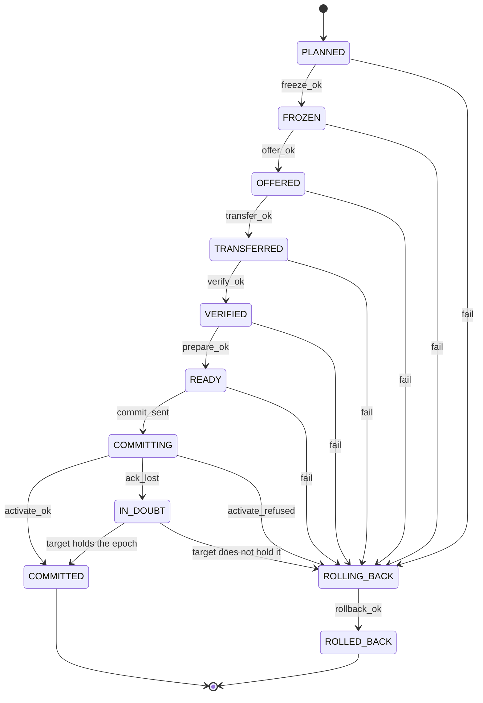
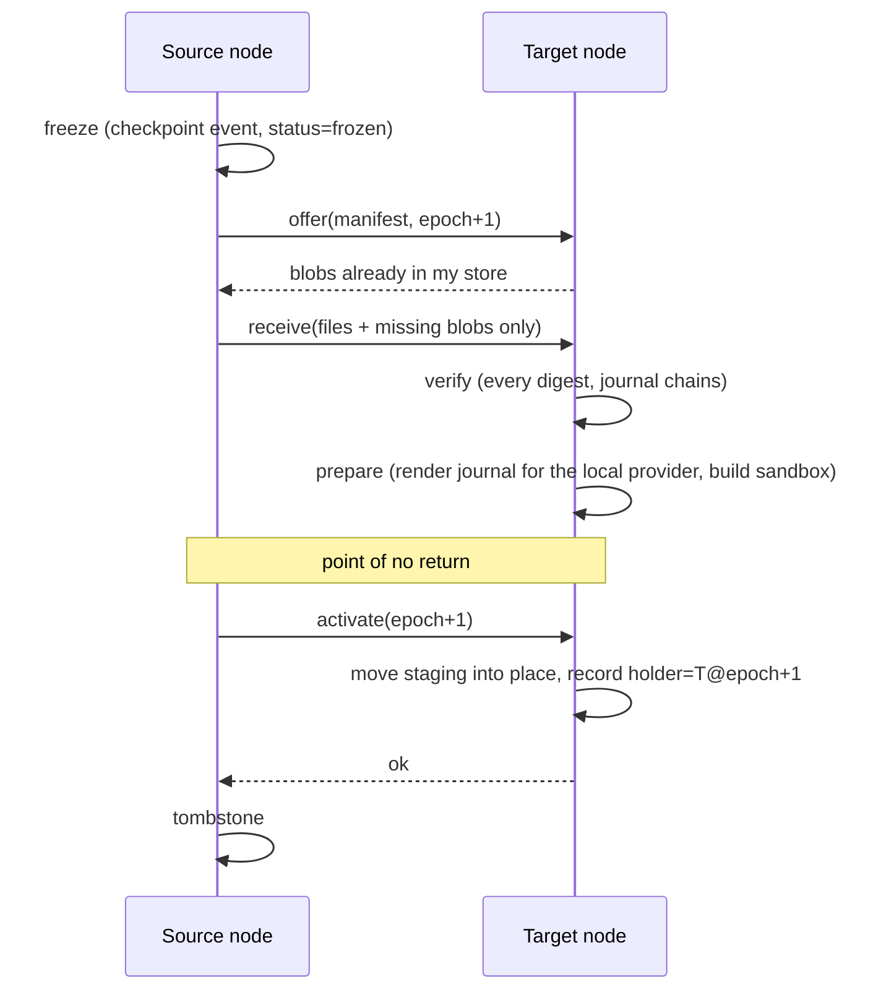

# Teleportation

Moving a running agent from node A to node B is a **two-phase commit with a
fencing epoch**. The invariant: *at most one node runs the agent, ever.*

## States

`fail` is not accepted from `COMMITTING` onward: past that point the outcome is
decided by the epoch, not by an error on one side.

## Sequence

## Rollback

Before `activate` is sent, any failure — a refused offer, a lost chunk, a digest
mismatch, a provider that cannot render the journal — leads to: ask the target to
discard its staging directory (best effort), then unfreeze the source **at its old
epoch**. The agent never stopped being the source's.

If the unfreeze itself fails the outcome says `needs_attention`: the agent is
frozen, not duplicated, and an operator or the next coordinator pass retries.

## The in-doubt window

The only ambiguous moment is a lost reply to `activate`: the target may or may not
have taken over. `resolve_in_doubt` is **stateless**, so it can run after a crash
and from either side:

1. Ask the target who holds the agent.
2. If it answers `(target, epoch+1)`: committed — tombstone the source.
3. If it answers anything else: the activation never happened — abort the staging
   and unfreeze the source.
4. If it cannot be reached: stay `IN_DOUBT`. The source remains frozen. Waiting
   costs availability, never correctness.

## Fencing

Each move offers `epoch + 1`. A node refuses an offer whose epoch is not newer than
the one it already holds (`StaleEpoch`), and `activate` must carry the epoch that
was offered. A node that was partitioned and wakes up with an old epoch can freeze
and offer, but cannot win.

## What is tested

`crates/inari-core/tests/teleport.rs` drives the real code with injected faults at every step:
lost request and lost reply on each phase, a corrupted chunk, a dead source read, a
stale epoch, an unreachable target during resolution, and a crash that loses the
holder record. After each, the test checks the invariant (one holder, staging
clean, capsule verifies).

## Heterogeneous nodes

`on_prepare` is the hook where the target proves it can host the agent: render the
journal in the schema of its own provider (see `handover`), compact it if the
local context window is narrower, and check the environment spec. A node that
cannot do so fails `prepare`, which is still before the point of no return.
